<p align="center">
  <a href="https://sunnyssah7.github.io/lab"></a>
</p>

<p align="center">
  <a href="https://sunnyssah7.github.io/lab"></a>
  <a href="https://www.linkedin.com/in/sandeep-sah-b8b35542b/"></a>
  <a href="https://x.com/sunnyysahh"></a>
  <a href="mailto:sunnyssah7@gmail.com"></a>
</p>

<p align="center">
  
</p>

```c
// sandeep.h
struct Sandeep {
    const char* base     = "Riverside, CA";
    const char* studying = "Electrical Engineering @ UCR";
    const char* building = "autonomy, edge AI, intelligent hardware";
    const char* research = "autonomous vehicles @ CE-CERT";
    const char* founder  = "Operator: a network for young builders";
    int         age      = 18;
    int         ventures = 5;   // 4 killed, 1 live. every one compounded.
};
```

### ▸ builds

| | project | what it does |
|---|---|---|
| 🤖 | **[autonomy-sim](https://github.com/sunnyssah7/autonomy-sim)** | A mobile robot in an unknown map. 120-beam LiDAR → log-odds occupancy grid → A* replanning → pure pursuit control. Goal in 44 s, 36 replans, 2.5 ms plans. |
| 🌐 | **[lab](https://sunnyssah7.github.io/lab)** | My site. A hand-written canvas PCB field, LiDAR sweep and traffic sim. No framework. |
| 🧠 | **edge-ai-node** *(queued)* | ESP32-class MCU + IMU running an int8 model on-device with TFLite Micro. Target: under 20 ms inference. |

<p align="center">
  <a href="https://github.com/sunnyssah7/autonomy-sim"></a>
</p>

### ▸ stack

<p>
  
  
  
  
  
  
  
</p>

**learning, in order:** `c/c++` → `embedded c` → `microcontrollers` → `tinyml` → `ros 2` → `verilog/fpga`

### ▸ telemetry

<p align="center">
  
  
</p>

<p align="center">
  <picture>
    <source media="(prefers-color-scheme: dark)" srcset="https://raw.githubusercontent.com/sunnyssah7/sunnyssah7/output/github-contribution-grid-snake-dark.svg">
    
  </picture>
</p>

<p align="center"><sub>shipping in public. if you're building in robotics or edge AI, my DMs are open.</sub></p>
