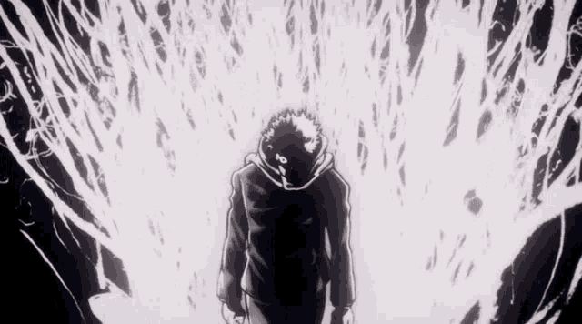

<p align="center">
  
</p>

<p align="center">
  
</p>

<p align="center">
  
</p>

<p align="center">
  <a href="https://sunnyssah7.github.io/lab"></a>
  <a href="https://www.linkedin.com/in/sandeep-sah-b8b35542b/"></a>
  <a href="https://x.com/sunnyysahh"></a>
  <a href="mailto:sunnyssah7@gmail.com"></a>
</p>


```bash
$ whoami
> sandeep sah · 18 · electrical engineering @ uc riverside

$ cat mission.txt
> put intelligence into physical machines. edge ai. robotics. autonomy.

$ ls ./current
> autonomous-vehicle-research@ce-cert   operator/   autonomy-sim/

$ uptime
> building since 16. no days off from the goal.
```


### ▸ /builds

<table>
<tr>
<td width="50%" valign="top">

**[`autonomy-sim`](https://github.com/sunnyssah7/autonomy-sim)** &nbsp;`shipped`

A robot dropped into a map it has never seen.<br>
LiDAR → log-odds occupancy grid → A* replanning → pure pursuit.<br>
<sub>44 s to goal · 36 replans · 2.5 ms plans</sub>

</td>
<td width="50%" valign="top">

**[`lab`](https://sunnyssah7.github.io/lab)** &nbsp;`live`

My corner of the internet. A hand-written canvas PCB field, a LiDAR sweep and a traffic sim.<br>
<sub>vanilla js · zero frameworks</sub>

</td>
</tr>
<tr>
<td width="50%" valign="top">

**`av-research`** &nbsp;`in progress`

Autonomous vehicle work at UCR CE-CERT, plus AV data analysis in an air-quality and transportation lab.

</td>
<td width="50%" valign="top">

**`edge-ai-node`** &nbsp;`classified`

`██████` on a microcontroller. `████` in, `██████████████` out. No cloud.<br>
<sub>declassifies when it ships.</sub>

</td>
</tr>
</table>

<details>
<summary><b>▸ watch the robot think</b></summary>
<br>
<p align="center"></p>
<p align="center"><sub>left: reality · right: what the robot believes · blue: the plan</sub></p>
</details>


### ▸ /stack

<p align="center">
  
</p>
<p align="center"><sub><code>python</code> · <code>numpy</code> · <code>path planning</code> · <code>occupancy mapping</code> · <code>control</code> · <code>circuits</code> → <code>embedded c</code> · <code>tinyml</code> · <code>ros 2</code> · <code>verilog</code></sub></p>


### ▸ /telemetry

<p align="center">
  
  
</p>

<p align="center">
  <picture>
    <source media="(prefers-color-scheme: dark)" srcset="https://raw.githubusercontent.com/sunnyssah7/sunnyssah7/output/github-contribution-grid-snake-dark.svg">
    
  </picture>
</p>

<p align="center">
  
</p>

<p align="center"><sub>// transmission end. the work speaks.</sub></p>
